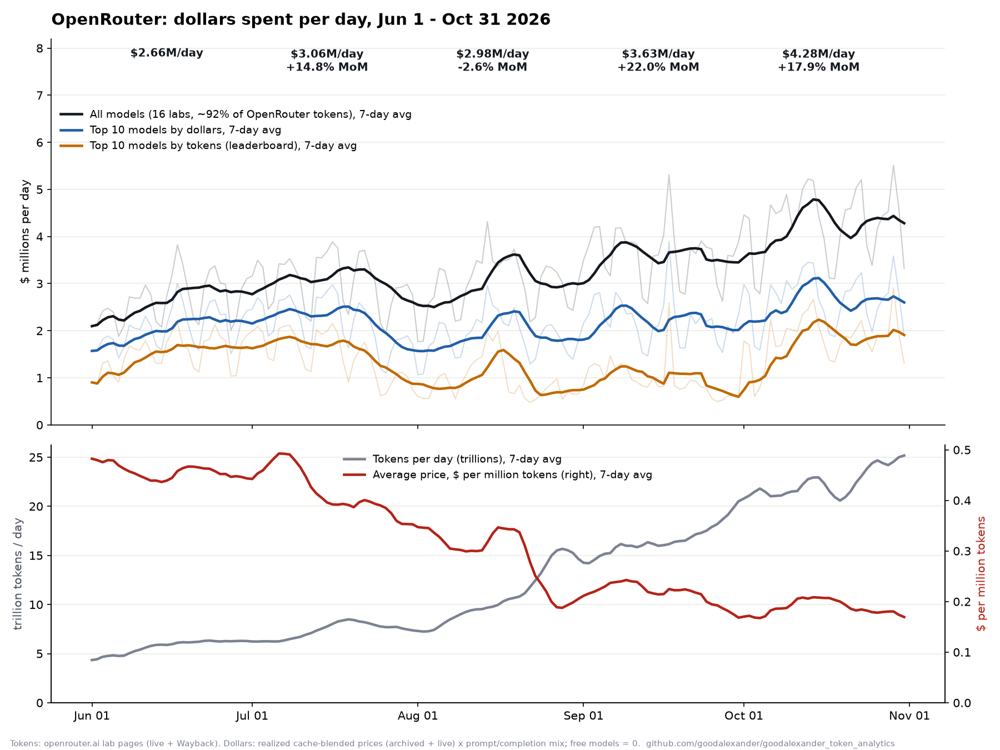

# goodalexander_token_analytics

**How many dollars flow through OpenRouter each day, and where they go.** A daily series of dollars spent on OpenRouter models
from June 1 to October 31 2026. It is built from OpenRouter's public per-model token counts and its realized
(cache-blended) prices. Every number in this README is rebuilt from the data in this repository by one command.



## Headline

- **Spend grew 61% in five months:** from **$2.66M a day in June to $4.28M a day in October**. The October run-rate is about **$1.6B a year**.
- **Usage nearly quadrupled:** tokens went from **5.9T to 22.9T a day** (3.9×).
- **The average price of a token fell 59%:** from **$0.455 to $0.187 per million tokens**. Growth is going to cheap,
  heavily cached models, and dollars grow far more slowly than usage.
- **The money stays concentrated.**
  - Claude Opus 5.5 alone took **18% of October's dollars** on **4% of its tokens**.
  - DeepSeek V4.1 Flash took **17% of October's tokens** for **4% of its dollars**.
  - Anthropic's share of dollars fell from **56% in June to 36% in October**, and OpenAI's rose from 12% to 20%.

## Month by month

Dollars per day, with month-on-month change in the daily rate, so 30- and 31-day months compare cleanly.

| Month | All models, $/day | MoM | Top 10 by $, $/day | MoM | Top 10 by tokens, $/day | MoM | Tokens/day | MoM | $ per M tokens |
|---|---|---|---|---|---|---|---|---|---|
| Jun 2026 | $2.66M | — | $2.05M | — | $1.51M | — | 5.86T | — | $0.455 |
| Jul 2026 | $3.06M | **+14.8%** | $2.19M | +6.6% | $1.50M | −0.6% | 7.46T | +27.4% | $0.410 |
| Aug 2026 | $2.98M | **−2.6%** | $1.89M | −13.6% | $0.93M | −38.2% | 11.38T | +52.5% | $0.262 |
| Sep 2026 | $3.63M | **+22.0%** | $2.23M | +18.0% | $0.96M | +3.3% | 17.37T | +52.6% | $0.209 |
| Oct 2026 | $4.28M | **+17.9%** | $2.67M | +19.6% | $1.82M | +90.4% | 22.86T | +31.6% | $0.187 |

Monthly totals: June $79.9M, July $94.8M, August $92.3M, September $108.9M, October $132.7M.

- **Top 10 by $** is each day's ten biggest models by dollars: 77% of all spend in June, 62% in October.
- **Top 10 by tokens** is each day's ten biggest models by tokens, the set OpenRouter's public leaderboard shows. It is
  mostly cheap, high-volume models. It swings when an expensive model crosses the token cut-off, as Claude Opus 5.5 did in
  early October.
- **August** is the one down month. Claude tokens fell as users moved from Claude 4.7/4.8 Opus to Claude Opus 5, and
  growth everywhere else made up most of the difference.

### October's ten biggest models by dollars

| Model | Share of Oct $ | Share of Oct tokens |
|---|---|---|
| anthropic/claude-opus-5.5 | 18.1% | 3.8% |
| openai/gpt-6-astra | 6.7% | 0.4% |
| anthropic/claude-sonnet-5.5 | 5.1% | 1.4% |
| openai/gpt-6.1-sol | 5.0% | 1.5% |
| stepfun/step-5-preview | 4.7% | 4.2% |
| moonshotai/kimi-k3 | 4.2% | 1.2% |
| z-ai/glm-5.3 | 4.1% | 2.8% |
| openai/gpt-5.6-sol | 3.9% | 0.5% |
| deepseek/deepseek-v4.1-flash | 3.6% | 16.8% |
| anthropic/claude-opus-5 | 3.4% | 0.4% |

## Method

**Tokens.**
- Each lab's OpenRouter page (`openrouter.ai/<lab>`) embeds 91 days of daily tokens per model (prompt + completion).
- We use the 16 labs that have had a model in OpenRouter's weekly top models over the past year, and stitch their live
  pages with Wayback Machine captures.
- For each (day, model), the newest source that lists the model wins. A capture's last day is partial and is dropped.

**Prices.** Every model-day is priced at OpenRouter's **realized** price, not list price. That is the cache-blended input
and output $/M actually billed, which for heavily cached models is a small fraction of list.
- **Price points** come from two places:
  - archived captures of OpenRouter's effective-pricing endpoint on the Wayback Machine, each giving the realized price
    over the ~7 days before it;
  - today's live realized price.
- **Interpolation:** each day's price is interpolated in time between the price points on either side of it.
- **Coverage:** 91–97% of each month's dollars from June to September rest on archived prices from that period.
- **Free models** (`:free`, stealth and cloaked) count as $0.

**Input/output mix.**
- Each model's tokens are split into prompt and completion using that model's own daily counts: archived
  model-activity captures for history, and the live 31-day window for recent days.
- The split matters because output tokens cost 10–40× more than input.

## Verification

`scripts/verify.py` and `scripts/verify_live_prices.py` run these checks.

1. **Token counts are exact.**
   - The lab-page chart value equals prompt + completion tokens from OpenRouter's per-model activity data, to within 0.2%.
   - Every week, the top models in OpenRouter's public weekly rankings chart match our daily sums exactly (ratio 1.0000).
   - Overlapping days of consecutive captures agree to within 0.2%.
2. **Coverage.** The 16 labs carry **88–95% of all tokens on OpenRouter** every week (mean 92%), measured against the
   platform-wide totals in the rankings chart. The dollars here cover those labs only.
3. **Prices, recomputed independently.**
   - For the 25 biggest models over the last 30 days, dollars rebuilt from OpenRouter's raw daily prompt/completion counts
     (standard and batch) × live realized prices land within **3.7%** of the pipeline.
   - Per-model gaps come from price drift within the month, such as higher realized prices in a model's first days after
     launch.
   - Batch traffic is 0.12% of tokens.
4. **Claude, from a second method.** An independent Claude series is built from archived model pages and cache-calibrated
   list prices (`data/claude`, `scripts/claude`). It agrees with this pipeline to within **4–10%** each month from August to
   October, consistent with that series' 6.5% calibration uplift.
5. **Robustness.** The share of dollars priced by carrying a model's price more than 45 days from its nearest price point:

   | Jun | Jul | Aug | Sep | Oct |
   |---|---|---|---|---|
   | 9% | 4% | 3% | 2% | 0% |

   If those prices were off by ±30%, June-to-October growth would land between **+56% and +65%**.

## Reproduce

```sh
python3 scripts/build.py                  # results/: daily_spend_by_model.csv, daily_series.csv, monthly.json
python3 scripts/verify.py                 # coverage, Claude cross-check, robustness
python3 scripts/chart.py                  # results/spend.png (needs matplotlib)
python3 scripts/verify_live_prices.py     # network: independent price recompute
```

Re-collect the raw data (network, slow; the Wayback Machine throttles requests):

```sh
python3 scripts/fetch_lab_pages.py        # data/raw: live + Wayback lab pages
python3 scripts/fetch_live_prices.py      # data/prices/live_effective.json
python3 scripts/build.py && python3 scripts/fetch_archived_prices.py   # data/prices/archived_*.json
```

No API keys are needed; every source is public.

## Files

| Path | Contents |
|---|---|
| `data/raw/live/`, `data/raw/wayback/` | OpenRouter lab pages as fetched (live, Nov 2 2026) and as archived by the Wayback Machine |
| `data/raw/rankings_chart.json` | OpenRouter's public weekly top-models chart, including the platform total |
| `data/prices/live_effective.json` | Live realized input/output price and 31-day daily prompt/completion tokens per model |
| `data/prices/archived_effective.json` | Archived realized prices: `[date, input $/M, output $/M, cache-hit rate]` per model |
| `data/prices/archived_activity.json` | Archived daily prompt/completion tokens per model |
| `data/claude/`, `scripts/claude/` | Independent Claude series used for the cross-check |
| `results/daily_spend_by_model.csv` | Every model-day: tokens, dollars and the price source used |
| `results/daily_series.csv`, `results/monthly.json` | Daily and monthly series |

## Caveats

- **Scope.** This covers the 16 labs that carry ~92% of OpenRouter tokens, not the remaining ~8%. It also covers
  OpenRouter only, not traffic that goes to labs directly, which is far larger for most of them.
- **"Dollars spent"** is tokens × realized price, including bring-your-own-key traffic, where the user pays the provider
  directly.
- **Prices** before October rest mainly on archived captures, each describing a ~7-day window. Between captures they are
  interpolated, and 2–9% of each month's dollars are priced by carrying a model's price further than 45 days (see
  Verification).

## License

Code: MIT. Data: derived from public OpenRouter pages and the Internet Archive's Wayback Machine.
